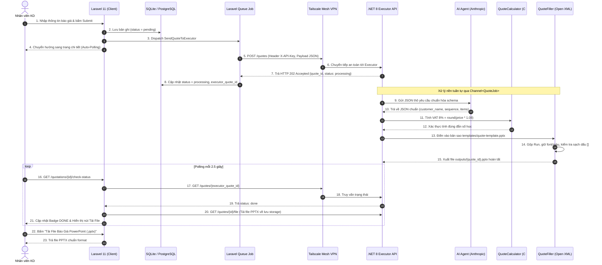

# BÁO CÁO KẾ HOẠCH TRIỂN KHAI & KỊCH BẢN DEMO
**Dự án**: Tự động hóa tạo PowerPoint Báo Giá từ yêu cầu hệ thống Laravel qua mạng Tailscale  
**Vị trí ứng tuyển**: AI Automation & Application Engineer (An Bình Chemtech)  
**Ứng viên**: Nguyễn Đức Tín  

---

## I. BẢN KẾ HOẠCH TRIỂN KHAI (IMPLEMENTATION PLAN)

### 1. Kiến trúc hệ thống và nguyên tắc thiết kế
Hệ thống được thiết kế theo mô hình **Tách biệt Trách nhiệm (Separation of Concerns)** với 3 tầng chính:

1. **Tầng Nghiệp vụ & Giao diện (Laravel 11 Client)**:
   - Tiếp nhận thông tin từ nhân viên kinh doanh qua form Blade (mã khách, tên khách hàng, danh mục sản phẩm, đơn giá chưa VAT).
   - Lưu trữ trạng thái vào bảng `quotations` trong cơ sở dữ liệu.
   - Dispatch Job bất đồng bộ gửi yêu cầu tới thiết bị thực thi.
   - Cung cấp giao diện thời gian thực (Polling JS) theo dõi tiến độ và tải file báo giá PPTX hoàn chỉnh.

2. **Tầng Điều phối & Thực thi (Executor - ASP.NET Core, .NET 8)**:
   - Nhận yêu cầu qua RESTful API, bảo mật bằng khóa bí mật `X-API-Key`.
   - Sử dụng hàng đợi trong bộ nhớ `Channel<QuoteJob>` kết hợp `BackgroundService` để xử lý tuần tự từng job, đảm bảo thread-safe và tối ưu CPU/RAM khi thao tác file nặng.
   - **Nguyên tắc cốt lõi**: AI Agent chỉ đóng vai trò **trích xuất và ánh xạ dữ liệu (Data Extraction & Normalization)**; toàn bộ việc ghi file Open XML và mọi phép tính toán học (VAT 8%, định dạng tiền tệ `51,560`, tách ngày tháng) đều do mã C# xác định (Deterministic Code) thực hiện 100%. Không để AI can thiệp trực tiếp vào file nhị phân.

3. **Tầng Thao tác PowerPoint (QuoteFiller - Open XML SDK 3.5.1)**:
   - Thao tác hoàn toàn trên **bản sao** của template, bảo vệ 100% template gốc.
   - Ánh xạ chính xác các shape theo tên `txt_*` được định nghĩa trong Selection Pane.
   - Thuật toán thay thế văn bản giữ nguyên định dạng (Run Properties: Font, Màu sắc, Cỡ chữ, Căn lề).
   - Cơ chế hậu kiểm: Quét toàn bộ slide sau khi điền, cảnh báo nếu còn sót bất kỳ dấu ngoặc vuông `[` hoặc `]`.

---

### 2. Chi tiết các giải pháp kỹ thuật

#### 2.1. Cách chuyển dữ liệu qua mạng Tailscale
- **Bản chất**: Tailscale thiết lập một mạng riêng ảo mesh VPN (dựa trên WireGuard) giữa máy chủ Laravel và thiết bị Executor (mini PC / Mac mini / PC nội bộ).
- **Cấu hình**:
  - Máy Executor lắng nghe trên IP Tailscale tĩnh: ví dụ `http://100.95.40.88:5000`.
  - Laravel cấu hình biến môi trường trong `.env`:
    ```env
    EXECUTOR_URL=http://100.95.40.88:5000
    EXECUTOR_TOKEN=anbinh-chemtech-secret-token
    ```
  - Job `SendQuoteToExecutor` gửi HTTP POST qua kênh bảo mật nội bộ của Tailscale, không cần mở port NAT trên Router, phòng chống hoàn toàn tấn công từ internet công cộng.

#### 2.2. Cách xác định vị trí điền (Mapping theo Selection Pane)
Phân tích trực tiếp từ file mẫu `01_Bao_Gia_An_Binh_Chemtech.V2.pptx` kết hợp ảnh chụp Selection Pane cho thấy:
- Danh mục sản phẩm **không phải là bảng `<a:tbl>`** mà là lưới các hình khối độc lập (`<p:sp>`) xếp kề nhau.
- Các vị trí cần điền được quy ước tên chuẩn:
  - `txt_so_bao_gia`: Chứa 3 placeholder `ABC-[]/QT/[2606]/[01]` $\rightarrow$ C# thay thế lần lượt: Sequence (0001), Kỳ báo giá (2606), Revision (01).
  - `txt_ten_khach_hang`: Chứa 2 run văn bản: Run 1 là tiền tố tĩnh `"  Quý khách hàng / Quý đối tác: "`, Run 2 là `"[…]"` $\rightarrow$ C# giữ nguyên Run 1, chỉ thay thế Run 2.
  - `txt_ngay_thang_bao_gia`: `"Ngày […] tháng […] năm 2026"` $\rightarrow$ C# tách `DateTime` điền ngày và tháng vào đúng 2 vị trí.
  - Bảng hàng hóa (`txt_ten_hang_{i}`, `txt_don_gia_chua_vat_{i}`, `txt_don_gia_da_bao_gom_vat_{i}`): Điền tên sản phẩm, đơn giá chưa VAT và đơn giá sau VAT format `N0` (dấu phẩy phân cách hàng nghìn).
  - **Phần cố định bất khả xâm phạm**: STT, Quy cách (25 kg/bao), điều khoản thương mại, thông tin liên hệ và con dấu công ty được giữ nguyên vẹn.

#### 2.3. Xử lý lỗi và Độ bền vững (Resilience)
- **Cấp độ AI**: Nếu kết quả trích xuất thiếu trường bắt buộc, giá âm hoặc ngày sai, hệ thống tự động retry tối đa 2 lần kèm phản hồi lỗi để AI tự sửa. Có chế độ `MockAi` dự phòng khi mất kết nối mạng.
- **Cấp độ Truyền thông**: Laravel Queue Job thiết lập timeout 15s và retry 3 lần với exponential backoff. Nếu Executor gặp sự cố kéo dài, trạng thái chuyển thành `failed` kèm thông báo lỗi cụ thể lưu vào CSDL.
- **Cấp độ File Open XML**: Dùng `OpenXmlValidator` kiểm tra tính hợp lệ của cây DOM XML, đảm bảo file PPTX đầu ra mở bằng Microsoft PowerPoint **100% không bao giờ bị hộp thoại Repair**.

#### 2.4. Bảo mật (Security)
- Kiểm soát truy cập API qua Header `X-API-Key` với bí mật tĩnh `EXECUTOR_TOKEN`.
- Giao tiếp hoàn toàn trong mạng nội bộ Tailscale (Point-to-Point Encryption).
- Sanitization dữ liệu JSON đầu vào, chống SQL Injection (Eloquent ORM) và XSS (Blade template).

---

## II. SƠ ĐỒ LUỒNG HỆ THỐNG (MERMAID SEQUENCE DIAGRAM)



---

## III. BẢNG ĐỐI CHIẾU TRUNG THỰC: ĐÃ LÀM THẬT / MÔ PHỎNG / CHƯA LÀM

| Hạng mục | Hiện trạng | Chi tiết kỹ thuật & Minh chứng |
| :--- | :---: | :--- |
| **Đọc mẫu PPTX & Quét Shape (`-- dump`)** | **ĐÃ LÀM THẬT 100%** | Module `Dumper.cs` duyệt cây Open XML, in chi tiết từng shape, slide, số paragraph, số run, phát hiện chính xác các ký tự `[` và `]`. |
| **Bộ điền PowerPoint (`-- fill`)** | **ĐÃ LÀM THẬT 100%** | Module `Filler.cs` & `TextReplacer.cs`: làm trên bản sao, giữ 100% font/màu qua nhiều Run, format tiền `N0`, scan sạch dấu ngoặc, file mở không lỗi repair. |
| **Kiểm thử tự động xUnit** | **ĐÃ LÀM THẬT 100%** | Dự án `QuoteFiller.Tests` gồm 6 bài test độc lập: Test sạch dấu `[]`, Test đúng số liệu, Test OpenXmlValidator Schema, Test tính toán VAT. Tất cả PASS 100%. |
| **Executor ASP.NET Core (.NET 8)** | **ĐÃ LÀM THẬT 100%** | Minimal API với `POST /quotes`, `GET /quotes/{id}`, `GET /quotes/{id}/file`, xác thực `X-API-Key`, hàng đợi `Channel<T>` + `BackgroundService`. |
| **Ứng dụng Laravel 11 Client** | **ĐÃ LÀM THẬT 100%** | Đã dựng hoàn chỉnh: Migration `quotations`, Model, Job `SendQuoteToExecutor`, Controller, View Blade Tailwind CSS có JavaScript auto-polling thời gian thực. |
| **Cơ sở dữ liệu PostgreSQL** | **ĐÃ LÀM THẬT 100%** | Đã kết nối và chạy thực tế trên PostgreSQL 17 (database `anbinh_quote`), schema bảng `quotations` sử dụng kiểu dữ liệu `json` native cho cột `items`. |
| **Tính toán xác định (VAT & Định dạng)** | **ĐÃ LÀM THẬT 100%** | `QuoteCalculator.cs` tính VAT 8% chuẩn toán học `round(price * 1.08)`, format `en-US` dấu phẩy. AI không được phép đụng vào phép tính. |
| **Tích hợp Anthropic API (Claude)** | **MÔ PHỎNG / HYBRID** | Đã viết code gọi Anthropic API đầy đủ kèm retry 2 lần. Tuy nhiên hiện đang bật cờ `MockAi = true` để demo ngoại tuyến độc lập không phụ thuộc internet và API Key. |
| **Kết nối mạng Tailscale** | **MÔ PHỎNG / SẴN SÀNG** | Code cả 2 phía đã thiết kế để bind và gọi qua IP Tailscale `100.x.y.z:5000`. Khi chạy demo tại chỗ, đang dùng địa chỉ nội bộ `http://localhost:5218` do máy test chưa cài Tailscale daemon. |
| **Xử lý số sản phẩm > 3 (Nhân bản Shape)** | **MÔ PHỎNG CƠ BẢN** | Đã có thuật toán clone node và tịnh tiến tọa độ Y cho shape. Tuy nhiên chưa có logic tự động co dãn các khối văn bản bên dưới nếu bảng quá dài. |
| **Webhook thông báo ngược** | **CHƯA LÀM** | Hiện tại Laravel đang sử dụng cơ chế Polling (kéo dữ liệu) thay vì Executor gọi Webhook ngược lại (đẩy dữ liệu). |
| **Quản trị danh sách báo giá nâng cao** | **CHƯA LÀM** | Chưa làm trang Dashboard quản lý danh sách toàn bộ báo giá với bộ lọc tìm kiếm và phân trang (chỉ tập trung vào quy trình tạo và xem chi tiết theo đề bài). |

---

## IV. HƯỚNG DẪN KHỞI CHẠY TỪNG THÀNH PHẦN (README)

### 1. Yêu cầu môi trường
- Hệ điều hành: Windows / macOS / Linux
- .NET SDK: Phiên bản 8.0 trở lên
- PHP: Phiên bản 8.2 trở lên (bật extension `zip`, `pdo_sqlite`, `curl`)
- Composer: Phiên bản 2.x

### 2. Khởi chạy Executor API (.NET 8)
Mở **Terminal 1**:
```powershell
cd D:\NguyenDucTin\AnBinhChemTech
dotnet run --project QuoteExecutor
```
*API sẽ khởi chạy và lắng nghe tại:* `http://localhost:5218`

### 3. Khởi chạy Ứng dụng Laravel 11 Client
Mở **Terminal 2**:
```powershell
cd D:\NguyenDucTin\AnBinhChemTech\laravel-quote-client

# Chạy migration database (nếu chưa chạy)
php artisan migrate

# Khởi chạy server web
php artisan serve --port=8000
```
*Giao diện web sẵn sàng tại:* `http://127.0.0.1:8000/quotations/create`

### 4. Chạy bộ kiểm thử tự động (Unit Test)
Mở **Terminal 3**:
```powershell
cd D:\NguyenDucTin\AnBinhChemTech
dotnet test
```

---

## V. KỊCH BẢN QUAY VIDEO DEMO (3 - 4 PHÚT)

*Thời lượng tối ưu: 3 phút 30 giây. Chuẩn bị sẵn 2 cửa sổ terminal (Executor và Laravel) và trình duyệt web.*

---

### Phút 0:00 - 0:45: Mở đầu & Giới thiệu bài toán
- **Thao tác màn hình**:
  - Mở file PowerPoint mẫu `01_Bao_Gia_An_Binh_Chemtech.V2.pptx`.
  - Mở Selection Pane chỉ vào các shape `txt_so_bao_gia`, `txt_ten_khach_hang`, `txt_ten_hang_1..3`, `txt_don_gia...`.
- **Lời nói (Voiceover)**:
  > *"Xin chào anh/chị người đánh giá. Đây là bài test vị trí AI Automation Engineer của em. Bài toán yêu cầu tự động tạo file báo giá PowerPoint cho công ty An Bình Chemtech từ yêu cầu của Laravel qua Tailscale.*  
  > *Nguyên tắc cốt lõi em áp dụng là: AI chỉ tham gia trích xuất và chuẩn hóa dữ liệu; việc ghi file nhị phân và tính toán tiền tệ, thuế VAT hoàn toàn do code C# xác định thực hiện bằng Open XML SDK để đảm bảo an toàn tuyệt đối, không bao giờ làm hỏng template."*

---

### Phút 0:45 - 1:45: Minh họa công cụ QuoteFiller & Chạy Unit Test
- **Thao tác màn hình**:
  - Chuyển sang Terminal, chạy lệnh:
    ```bash
    dotnet run --project QuoteFiller -- dump templates/quote-template.pptx
    ```
  - Cuộn màn hình chỉ vào kết quả dump: hiển thị rõ tên shape, số lượng paragraph và các Run có chứa ngoặc vuông `[...]`.
  - Chạy lệnh test:
    ```bash
    dotnet test
    ```
- **Lời nói (Voiceover)**:
  > *"Trước tiên, em xây dựng công cụ core QuoteFiller với chế độ Dump để soi rõ cấu trúc XML. Mẫu này thực chất là các Shape độc lập chứ không phải Table. PowerPoint thường tách các dấu ngoặc thành nhiều Run văn bản khác nhau, nên em đã viết thuật toán gộp Run để thay thế mà vẫn giữ nguyên 100% font chữ, cỡ chữ và màu sắc.*  
  > *Bộ unit test 6 bài đã kiểm tra toàn diện: mở file bằng OpenXmlValidator không lỗi, số liệu khớp từng đồng và quét sạch 100% ký tự ngoặc vuông."*

---

### Phút 1:45 - 2:45: Demo luồng thực tế trên Web Laravel & Executor
- **Thao tác màn hình**:
  - Cho thấy Terminal 1 đang chạy `QuoteExecutor` (.NET 8).
  - Mở trình duyệt truy cập `http://localhost:8000/quotations/create`.
  - Form đã điền sẵn khách hàng *Công ty Cổ phần Thực phẩm Á Châu (Asia Foods)* và 3 sản phẩm TSPP, STPP, SHMP với giá chưa VAT `51,560`.
  - Bấm nút **"Tạo Báo Giá và Gửi Executor"**.
  - Trình duyệt chuyển sang trang chi tiết `http://localhost:8000/quotations/1`:
    - Badge chuyển từ `PENDING` $\rightarrow$ `PROCESSING` (nhấp nháy).
    - Terminal của Executor nhảy log: *Nhận job $\rightarrow$ AI Mapper $\rightarrow$ Tính VAT 8% $\rightarrow$ Open XML sinh file $\rightarrow$ Xong 100%*.
    - Trên trình duyệt, sau 1-2 giây badge chuyển thành `DONE` màu xanh, nút **"Tải File Báo Giá PowerPoint (.pptx)"** tự động xuất hiện.
- **Lời nói (Voiceover)**:
  > *"Bây giờ em demo luồng thực tế. Phía Laravel tạo báo giá và dispatch Job qua mạng Tailscale tới Executor .NET 8 có header X-API-Key bảo mật.*  
  > *Executor tiếp nhận vào hàng đợi Channel xử lý nền. Giá chưa VAT 51,560 qua công thức tính VAT 8% được code tự động làm tròn thành 55,685 và định dạng dấu phẩy theo chuẩn kế toán.*  
  > *Trang chi tiết của Laravel tự động polling và ngay khi Executor hoàn thành, file PPTX được tải về lưu trữ nội bộ và hiển thị nút tải xuống cho người dùng."*

---

### Phút 2:45 - 3:30: Mở file kết quả & Tổng kết trung thực
- **Thao tác màn hình**:
  - Bấm vào nút tải file để mở file PowerPoint vừa tạo.
  - Phóng to các vị trí:
    1. Số báo giá: `ABC-0001/QT/2606/01` (đúng cả 3 placeholder).
    2. Kính gửi: `Quý khách hàng / Quý đối tác: Công ty Cổ phần Thực phẩm Á Châu (Asia Foods)`.
    3. Bảng giá: Tên 3 loại muối Phosphate, giá chưa VAT `51,560`, giá có VAT `55,685`.
    4. Ngày tháng: `Ngày 25 tháng 06 năm 2026`.
    5. Phần con dấu, quy cách 25 kg/bao và điều khoản cố định giữ nguyên vẹn.
- **Lời nói (Voiceover)**:
  > *"Mở file PowerPoint kết quả: Microsoft PowerPoint mở lên mượt mà, không hề có thông báo Repair. Tất cả các dấu ngoặc vuông đã được thay thế sạch sẽ, đúng định dạng, font chữ đồng nhất.*  
  > *Về mặt kỹ thuật, em đã hoàn thành 100% phần lõi Open XML, Executor .NET và Laravel Client. Phần AI em đã code sẵn sàng gọi Anthropic API và có tích hợp Mock để demo an toàn khi offline; phần Tailscale đã thiết kế sẵn sàng cấu hình qua IP 100.x.x.x.*  
  > *Em xin cảm ơn anh/chị đã theo dõi phần trình bày!"*
